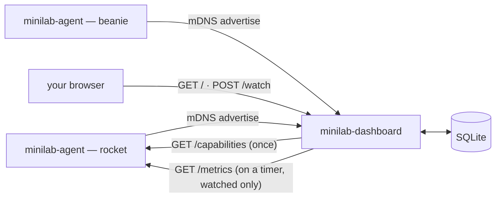

# minilab-dashboard


The single-instance dashboard for a home lab of Raspberry Pis, Orange Pis, and whatever else
ends up on the shelf. It discovers every [`minilab-agent`](https://github.com/robotjoosen/minilab-agent)
instance over mDNS, lets you pick which discovered services to watch, polls
them on a timer, and serves a web UI showing device and service health.

Part of the Mini Lab Monitoring Dashboard initiative — this is Phase 1: pure observability, no
deploys, no config writes, nothing that can break a box from here.

## What it actually does

- **Discovers** `minilab-agent` instances over mDNS, no static registry to keep in sync
- **Interviews** each one via `GET /capabilities` once, so the store knows what services exist
  before anyone's chosen to watch them
- **Polls** only the services you've explicitly watched, on a timer, via `GET /metrics`
- **Marks a device unreachable** after 3 consecutive failed polls, and back online on the next
  success
- **Serves** a web UI that only ever reads from its own SQLite — no page load blocks on a live
  call out to an agent
- Stays read-only: nothing here writes configuration or triggers a deploy on any device



## Endpoints

| Endpoint | Method | Purpose |
|---|---|---|
| `/` | `GET` | Device/service status grid, rendered from the local store |
| `/watch` | `POST` | Toggle whether a discovered service is polled |

## Quick start

On the target device (rocket):

```bash
curl -fsSL https://raw.githubusercontent.com/robotjoosen/minilab-dashboard/main/scripts/install.sh | bash
```

Or download and inspect it first (recommended for anything piping into a shell):

```bash
curl -fsSLO https://raw.githubusercontent.com/robotjoosen/minilab-dashboard/main/scripts/install.sh
chmod +x install.sh
./install.sh
```

It pulls the matching binary from the
[latest release](https://github.com/robotjoosen/minilab-dashboard/releases), and walks through
setting it up as a systemd service — asking for the HTTP listen address, SQLite path, mDNS
service names, and poll/discovery intervals, confirming before every system-changing step
(creating the data directory, writing the unit file, enabling/starting the service).

To update later:

```bash
curl -fsSL https://raw.githubusercontent.com/robotjoosen/minilab-dashboard/main/scripts/update.sh | bash
```

`update.sh` preserves whatever's already configured and only asks for values genuinely missing
from the existing install (e.g. a setting a newer release added).

To remove it entirely:

```bash
curl -fsSL https://raw.githubusercontent.com/robotjoosen/minilab-dashboard/main/scripts/uninstall.sh | bash
```

`uninstall.sh` stops and disables the service, then confirms before removing the unit file, the
binary, and — separately, since it holds real state — the data directory (discovered devices and
watch selections).

None of `scripts/install.sh`, `scripts/update.sh`, or `scripts/uninstall.sh` are published as
release assets — they're fetched straight from `main` each time, same as the install command
above. If you downloaded `install.sh` to disk instead of piping it, fetch the other two the same
way rather than expecting them to already be sitting next to it.

## Configuration

Set as environment variables, or in a `.env` file next to the binary — see `.env.dist` for
defaults.

| Variable | Default | Description |
|---|---|---|
| `LOG_LEVEL` | `INFO` | slog level |
| `HTTP_LISTEN_ADDR` | `:8080` | Where the web UI is served |
| `SQLITE_PATH` | `./minilab-dashboard.db` | Path to the dashboard's own database |
| `MDNS_AGENT_SERVICE_NAME` | `_minilab-agent._tcp` | mDNS service type to browse for agents |
| `DISCOVERY_INTERVAL` | `1m` | How often to re-browse mDNS |
| `POLL_INTERVAL` | `15s` | How often to poll watched services |
| `UNREACHABLE_THRESHOLD` | `3` | Consecutive failed polls before a device is marked unreachable (min 1) |
| `TLS_CA_FILE` | empty | PEM of the private CA that signs every certificate (agents, dashboard, browsers) |
| `TLS_CLIENT_CERT_FILE` | empty | Certificate the dashboard shows to agents (`clientAuth`) |
| `TLS_CLIENT_KEY_FILE` | empty | Its private key |
| `TLS_CERT_FILE` | empty | Certificate for the web UI (`serverAuth`) |
| `TLS_KEY_FILE` | empty | Its private key |

`DISCOVERY_INTERVAL` and `POLL_INTERVAL` must be greater than zero; the dashboard refuses to
start otherwise.

### Mutual TLS

Works with [minilab-agent](https://github.com/robotjoosen/minilab-agent)'s mTLS and its
`scripts/gen-certs.sh`. Both halves are optional and independent; setting a cert without its
key, or either without `TLS_CA_FILE`, is a startup error.

```bash
# in minilab-agent, on a machine you trust (ca.key stays offline)
./scripts/gen-certs.sh ca
./scripts/gen-certs.sh server rocket          # one per agent device -> agent's TLS_CERT/KEY
./scripts/gen-certs.sh client dashboard       # dashboard -> agents: TLS_CLIENT_CERT/KEY
./scripts/gen-certs.sh server dashboard-ui 192.168.8.203   # web UI: TLS_CERT/KEY
./scripts/gen-certs.sh client roald           # a browser client certificate (import as .p12)
```

- **Agent calls** — set `TLS_CA_FILE`, `TLS_CLIENT_CERT_FILE`, `TLS_CLIENT_KEY_FILE`. Calls to
  agents go over `https://`, present the client certificate, and only accept agents signed by
  the CA. Without them calls are plain `http://`, matching agents run with `TLS_DISABLED=true`;
  one setting covers every agent, so a mixed fleet is not supported.
- **Web UI** — set `TLS_CA_FILE`, `TLS_CERT_FILE`, `TLS_KEY_FILE`. The UI is served over HTTPS
  and every browser must present a client certificate from the CA. Use the `server` role (the
  browser needs a `serverAuth` certificate whose name or IP matches the address you open).

Agents are found by IP over mDNS and DHCP addresses change, so an agent's certificate is checked
against the CA but **not against its hostname/IP**; keep the CA private and used for nothing
else. Certificates are read at startup: restart after renewing.

## Development

Requires [Task](https://taskfile.dev) and Go (whatever version `go.mod` currently pins — it
floats as dependencies require newer minimums, deliberately not locked to match the rest of the
lab).

```bash
task build     # cross-compiles for linux/arm64
go test ./...
gofmt -l .
```

### Project layout

```
cmd/app/               entrypoint — env loading, wiring everything together
pkg/domain/             shared data structs only (Device, Service, HostStats) — no logic
pkg/store/              SQLite persistence — devices, services, host stats
pkg/metricsparse/       Prometheus text format parser for an agent's /metrics response
pkg/agentclient/        HTTP client for an agent's /capabilities and /metrics
pkg/registration/       mDNS-sighting → capabilities interview → store upsert
pkg/poller/             periodic /metrics poll → store update for watched services
pkg/discovery/          mDNS browser
pkg/web/                HTTP handlers + templates — the status grid and watch toggle
pkg/env/                env-to-struct loading (shared with go-health-service's own copy)
pkg/tlsconf/            mutual-TLS client/server configs from the private CA
```

### Testing convention

Exported functions/methods are tested black-box, from `package foo_test` — importing the
package like any real caller would, so tests can't quietly depend on internal details of what's
supposed to be a clean API.

## Releasing

CI (`go vet`, `go test`) runs on every push and pull request. Push a tag matching `v*`:

```bash
git tag v0.1.0
git push origin v0.1.0
```

The [release workflow](.github/workflows/release.yml) cross-compiles for linux/arm64 and
publishes it as `minilab-dashboard-linux-arm64` (plus a `.sha256` that the install/update scripts verify before installing) — the exact name `scripts/install.sh` and
`scripts/update.sh` look for.

## Design notes

- **The UI never blocks on a live agent call.** Every page load reads only from the dashboard's
  own SQLite — an unreachable agent slows down nothing but its own next poll.
- **Only watched services get polled.** Discovery populates the full list of what an agent
  reports, but polling — the thing that costs a network round trip every interval — only happens
  for services someone explicitly opted into watching.
- **A poll is one transaction.** Host stats, temperatures and watched-service states land
  together or not at all, and sensors/services an agent stops reporting are removed.
- **A single SQLite connection.** This is a single-process, single-instance dashboard, so the
  store forces `SetMaxOpenConns(1)` rather than letting pooled connections arbitrate file locks
  with each other.

## Related

- [minilab-agent](https://github.com/robotjoosen/minilab-agent) — the per-device agent this
  dashboard discovers and polls
- [go-health-service](https://github.com/robotjoosen/go-health-service) — publishes the host
  stats each agent subscribes to
